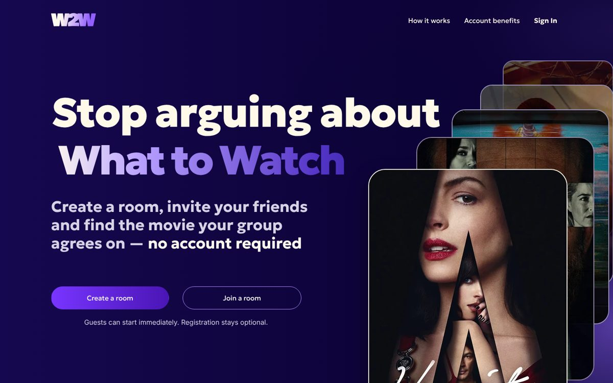
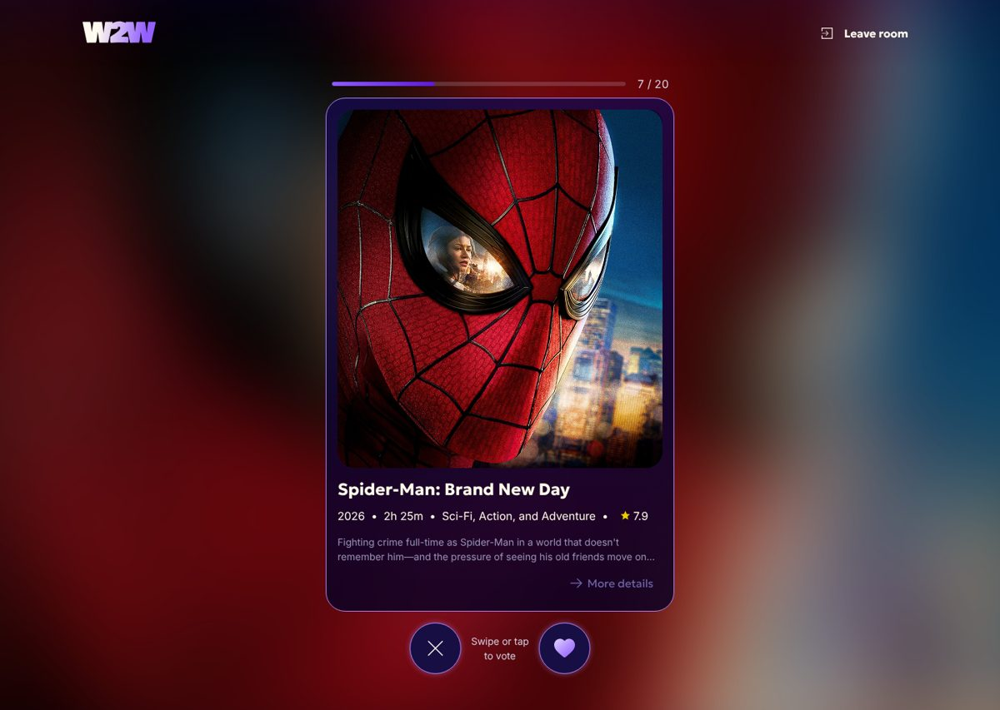
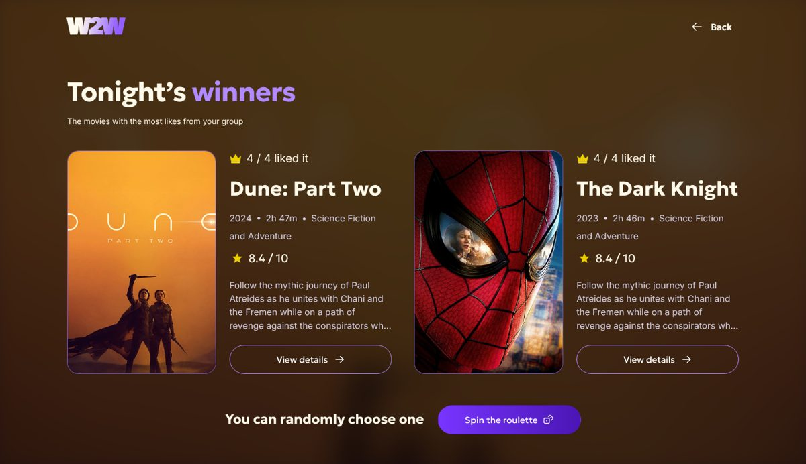

# W2W — What to Watch

**Stop arguing about what to watch.** Create a room, invite friends with a link or QR code, swipe
through the same 20 movies and get the film your whole group agrees on — no account needed.

**Live demo:** https://what2watch.duckdns.org

> The demo runs on a small AWS server that is switched off at night (22:00–08:00 EET, Kyiv time). If it is offline, see the screenshots below.



| Swipe session                                | Results                                  |
| -------------------------------------------- | ---------------------------------------- |
|  |  |

## Try it

1. Open the demo and press **Create a room**, pick a content type, genres and duration.
2. Open the invite link in a second browser or a private window and join with another name.
3. The host presses **Start session**; everyone swipes the same 20 movies (like / skip, arrows or drag).
4. When everybody is done, the results appear: the winner, or several winners and a roulette for the host.

The frontend talks to the Team 262 Spring Boot backend (movies from TMDB) through the same domain (`/api`).

## Features

- Guest rooms for up to 5 people, invite by link, QR code or Telegram
- Swipe voting with live group progress, resumes after a reload
- Results with ties, a fair roulette and "no match" handling
- Leaving the room passes the host role on; movie details for every card
- Pixel-matched to the Figma design (`design/`), keyboard and screen-reader friendly

## Tech stack

React 19 · React Router 7 · TypeScript (strict) · TanStack Query · Vite 8 · plain CSS (BEM) ·
Vitest + Testing Library · ESLint (hooks, jsx-a11y, typescript-eslint) · Prettier + Husky pre-commit ·
Google Analytics 4 · Docker + Nginx · GitHub Actions → GHCR → AWS EC2

## Quick start

```bash
npm install
npm run dev        # http://localhost:5173, /api is proxied to http://localhost:8080
```

Backend elsewhere? Copy `.env.example` to `.env.local` and set `BACKEND_URL`.
Before a PR run `npm run check` (format, lint, typecheck, tests, build).

## More

- [AGENTS.md](AGENTS.md) — commands, folder map and conventions (for teammates and AI agents)
- [CONTRIBUTING.md](CONTRIBUTING.md) — Git flow and pull requests
- [docs/architecture.md](docs/architecture.md) — how browser, gateway and backend fit together
- [docs/docker-and-deployment.md](docs/docker-and-deployment.md) — Docker image, CI/CD, infra repo
