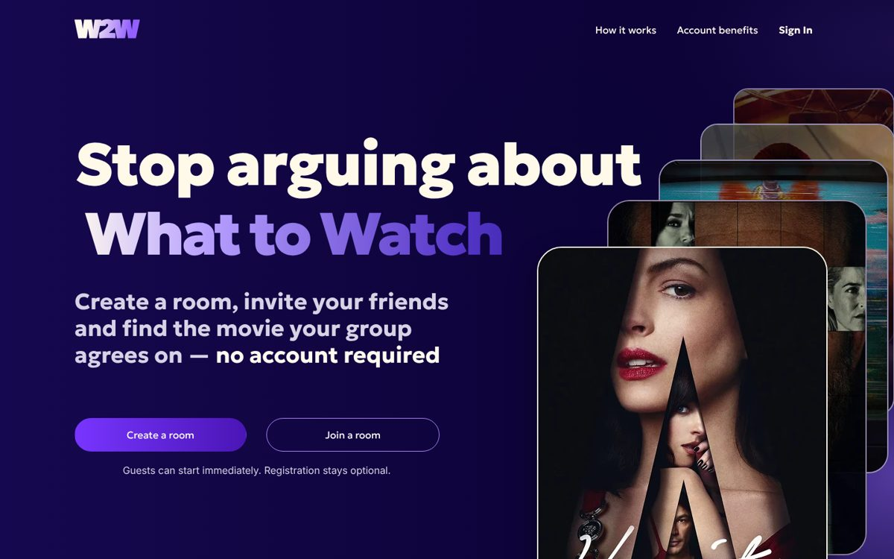
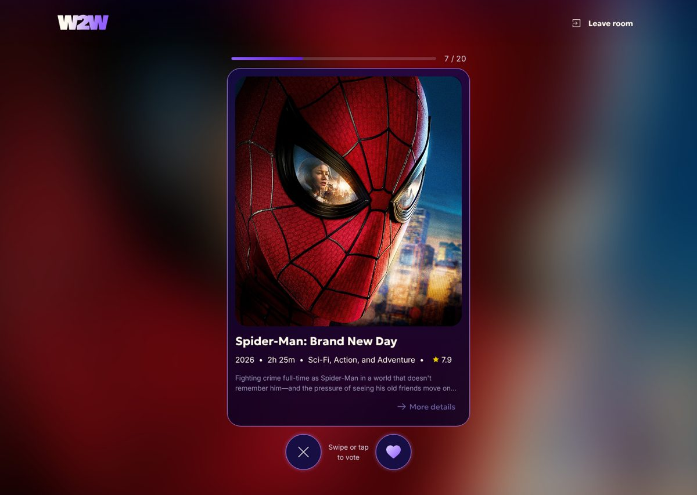
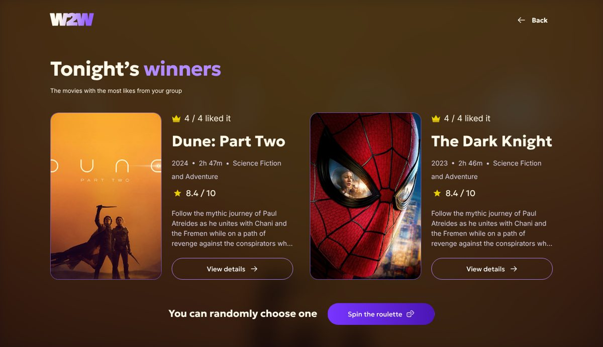

# 🎬 W2W — What to Watch

<!-- prettier-ignore-start -->
<!-- =========================================================================
     SECTION 1: UNIFIED PROJECT OVERVIEW (KEEP IDENTICAL ACROSS ALL 4 REPOS)
     ========================================================================= -->

[](https://github.com/mate-team-project-262/infra/actions/workflows/infra-ci.yml)
[](https://github.com/mate-team-project-262/infra/actions/workflows/infra-cd.yml)
[](https://github.com/mate-team-project-262/backend/actions)
[](https://github.com/mate-team-project-262/frontend/actions)

**Stop arguing about what to watch.** W2W (What to Watch) is a real-time collaborative movie picker: create a room, invite friends via link, 6-character code, or QR code, swipe through the same 20 curated TMDB movies, and let the interactive match roulette pick the film your whole group agrees on — no account required.

## 🌐 Live Demo & Endpoints

* **Live Application:** [https://what2watch.duckdns.org](https://what2watch.duckdns.org)
* **OpenAPI / Swagger UI:** [https://what2watch.duckdns.org/swagger-ui/index.html](https://what2watch.duckdns.org/swagger-ui/index.html)
* **Edge Gateway Health:** [https://what2watch.duckdns.org/gateway-health](https://what2watch.duckdns.org/gateway-health)

> **Availability note:** To optimize AWS Free Tier costs, an automated FinOps schedule pauses the cloud servers overnight (**22:00–08:00 EET, Kyiv time**). If the live demo is sleeping, see the screenshots below.



| Swipe Session | Match Results |
| :---: | :---: |
|  |  |

### Try it in 60 seconds
1. Open the Live Application and click **Create a room**, then choose content type, genres, and duration.
2. Open the invite link in a second browser or incognito window and join under another name.
3. The host clicks **Start session**; everyone swipes through the same 20 movies (like or skip).
4. When everyone finishes, view the matched winner — or spin the fair roulette to break a tie.

## 🧩 Repository Ecosystem

The platform is organized into four repositories connected by a unified GitHub Actions + GHCR + AWS EC2 delivery pipeline:

```text
Browser (HTTPS) ─▶ Nginx Gateway (TLS, CSP/HSTS, Rate Limiting)
                     ├─ /       ─▶ React SPA (frontend)
                     └─ /api/*  ─▶ Spring Boot API (backend) ─▶ AWS RDS MySQL + TMDB / Gmail SMTP
```

| Repository | Responsibility | Core Tech Stack |
| :--- | :--- | :--- |
| **[`frontend`](https://github.com/mate-team-project-262/frontend)** *(this repo)* | SPA UI: room lobby, swipe deck, profiles, match roulette | React 19, TypeScript, TanStack Query, Vite 8, Nginx |
| **[`backend`](https://github.com/mate-team-project-262/backend)** | REST API, room state machine, voting engine, TMDB & SMTP | Java 21, Spring Boot 3.5, Liquibase, MySQL 8.0, Testcontainers |
| **[`infra`](https://github.com/mate-team-project-262/infra)** | AWS Terraform IaC, Docker Compose, SSL Gateway, Observability | Terraform, AWS (EC2/RDS/VPC/S3), Nginx, Prometheus, Grafana |
| **[`analytics`](https://github.com/mate-team-project-262/analytics)** | Data cleaning, EDA, survey & product metrics visualization | Python 3, Jupyter Notebook, Pandas, NumPy, Matplotlib, Seaborn |

## 🚀 Run the Entire Stack Locally (3 Steps)

Spin up the full platform locally (Nginx Gateway, React Frontend, Spring Boot Backend, and MySQL 8.0) via the `infra` repository — no external TMDB API key required (`TITLE_SOURCE=stub` is enabled by default):

```bash
git clone https://github.com/mate-team-project-262/infra.git && cd infra/compose
cp .env.example .env
docker compose up -d
```
<!-- prettier-ignore-end -->

---

## 💻 Frontend (this repository)

The SPA of W2W: everything the user sees and taps. It talks to the backend only through the same
domain (`/api`), so no CORS is needed in production.

### Features

- Guest rooms for up to 5 people, invite by link, QR code or Telegram
- Swipe voting (drag, buttons or keyboard) with live group progress, resumes after a reload
- Results with ties, a fair roulette and "no match" handling
- Accounts: sign in / sign up, password reset by email, profile photo, session history and details
- "Movie identity": your favourite genres (SVG chart), eras and actors
- Pixel-matched to the Figma design (`design/`) on desktop and phones down to 320px; keyboard and
  screen-reader friendly
- SEO for the public pages; privacy-friendly analytics (no names, emails or room codes)

### Tech stack

React 19 · React Router 7 · TypeScript (strict) · TanStack Query · Vite 8 · plain CSS (BEM) ·
Vitest + Testing Library · ESLint (hooks, jsx-a11y, typescript-eslint) · Prettier + Husky pre-commit ·
Google Analytics 4 · Docker + Nginx · GitHub Actions → GHCR → AWS EC2

### Quick start (frontend only)

Needs Node.js 20.19 or newer (`node -v`; the version is also in `.nvmrc`).

```bash
npm install
npm run dev        # http://localhost:5173, /api is proxied to http://localhost:8080
```

Backend elsewhere? Copy `.env.example` to `.env.local` and set `BACKEND_URL`.
Before a PR run `npm run check` (format, lint, typecheck, tests, build).

### More

- [AGENTS.md](AGENTS.md) — commands, folder map and conventions (for teammates and AI agents)
- [CONTRIBUTING.md](CONTRIBUTING.md) — Git flow and pull requests
- [docs/architecture.md](docs/architecture.md) — how browser, gateway and backend fit together
- [docs/docker-and-deployment.md](docs/docker-and-deployment.md) — Docker image, CI/CD, infra repo
