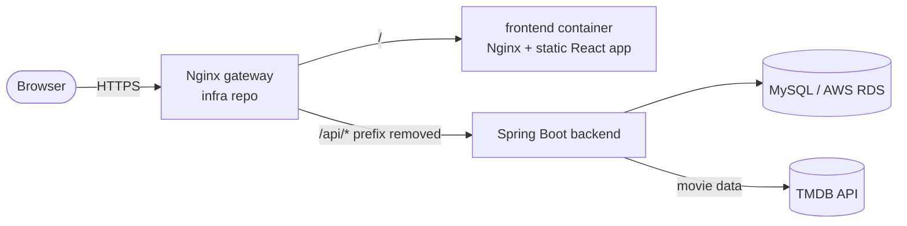
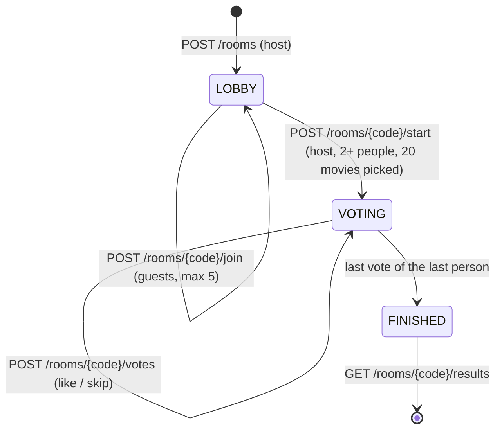

# Architecture

## Runtime

The React app is a static SPA. All API calls go to `/api/...` on the same origin; the gateway forwards
them to the backend. In development Vite's proxy does the same (`vite.config.js`, `BACKEND_URL`).

## Room flow

`/room/:code` is one route: `RoomPage` reads the room and shows

| Status     | Host                                                | Guest        |
| ---------- | --------------------------------------------------- | ------------ |
| `LOBBY`    | Lobby (invite link, QR, Start session)              | Waiting room |
| `VOTING`   | Swipe page, then "You're done!" with group progress | same         |
| `FINISHED` | Results with the roulette when there is a tie       | Results      |

Leaving (`POST /rooms/{code}/leave`) passes the host role to the next person; a host who is alone
deletes the room. Everybody else notices through polling and sees a toast.

## Identity

There are no accounts. Creating or joining a room returns a participant token, kept per tab in
`sessionStorage` (`api/roomSession.ts`) and sent as `X-Participant-Token`. The participant id tells
the app which person in the list is "me".

## Server data: TanStack Query, live updates by polling

Everything that comes from the backend is read through TanStack Query (`@tanstack/react-query`); the
hooks in `hooks/` wrap `useQuery` / `useMutation` and the pages never deal with loading state by hand.
Settings and query keys live in `api/queryClient.ts`.

| Hook              | Resource                     | How it stays fresh                                                       |
| ----------------- | ---------------------------- | ------------------------------------------------------------------------ |
| `useRoom`         | `GET /rooms/{code}`          | `refetchInterval` 3 s; stops for good on an expired pass / deleted room  |
| `useGameProgress` | `GET /rooms/{code}/progress` | `refetchInterval` 3 s while the "You're done!" screen is open            |
| `useRoundResults` | `GET /rooms/{code}/results`  | loaded once; `retry` every 3 s while the backend says `RESULT_NOT_READY` |
| `useDeck`         | `GET /rooms/{code}/deck`     | loaded once; each saved vote (`useMutation`) is written into the cache   |

The backend has no WebSocket, so "live" means polling every 3 seconds (the interval the backend asks
for). A failed poll keeps the last known data. Trade-off: up to 3 seconds of delay and extra requests;
a WebSocket / SSE endpoint on the backend would remove both and only `useRoom` / `useGameProgress`
would change.

Choices worth knowing:

- `retry: false` by default - POST requests are never repeated (no idempotency keys on the backend).
- `gcTime: 0` - room data belongs to one person's pass (token), so nothing is reused after the page
  is closed: after leaving or joining again the data always comes from the backend.

## Code layout

- `api/` — the only place that knows backend field names; returns frontend shapes (`Room`, `MovieCard`,
  `RoundResults`) and `RoomApiError` with user-safe messages.
- `hooks/` — page logic: `useRoom`, `useDeck` (voting), `useSwipeDrag`, `useGameProgress`,
  `useRoundResults`, `useRoulette` (fair random pick among tied winners), `useHostChange`.
- `pages/` and `components/` — rendering; `Brand*` components implement the UI kit.

## TypeScript

The whole app is TypeScript in `strict` mode (`npm run typecheck`, also part of `npm run check`):
logic in `.ts` (`api/`, `hooks/`, `utils/`, `config/`, `data/`), components and pages in `.tsx`.

- `api/types.ts` holds the shapes the pages use (`Room`, `MovieCard`, `RoundResults` ...) and,
  separately, the backend JSON (`*Dto`). Only `api/rooms.ts` and `api/game.ts` touch the Dto types.
- Every component declares its props; wrappers of HTML elements extend the element's own props
  (`ComponentPropsWithoutRef<'button'>`), so `disabled`, `onClick`, `aria-*` are checked too.
- No `any` in the app code (ESLint: `typescript-eslint` recommended rules).

## SEO and link previews

The app is a single `index.html`, so page metadata is handled in two places that share
`src/data/seo.ts` (texts from the marketer):

- in the browser `usePageMeta()` sets the title, description, canonical link and Open Graph tags of
  the current page; rooms and invite links get `noindex` instead;
- at build time `vite.config.js` writes `dist/create-room.html` and `dist/join.html`: copies of
  `index.html` with that page's tags, for crawlers and messengers that do not run JavaScript.
  Nginx serves them when its fallback is `try_files $uri $uri.html $uri/ /index.html;`.

`public/sitemap.xml` lists the three public pages, `public/robots.txt` closes `/room/`, `/join/CODE`
and `/api/`.

## Analytics

Google Analytics 4, loaded by `src/analytics/analytics.ts` only on the real site (not in
development, tests or on localhost; `?ga_debug=1` turns on DebugView). Pages call
`track(name, params)` with a typed list of events: `page_view`, `room_created`, `room_joined`,
`friend_invited`, `movie_swiped`, `movie_matched`, `selection_completed`.

Privacy rules built into the module: names are never sent, room codes are cut out of page
addresses (`/room/:code`), and the once-per-room events are not repeated after a reload.
The production CSP (gateway in the infra repo) must allow `googletagmanager.com` and
`google-analytics.com`.
